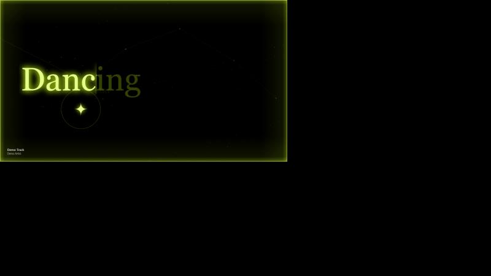
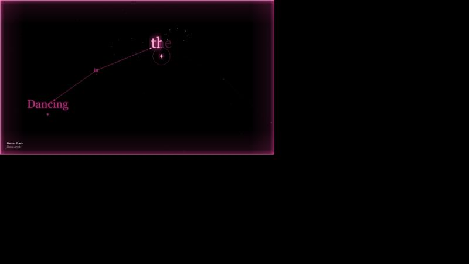
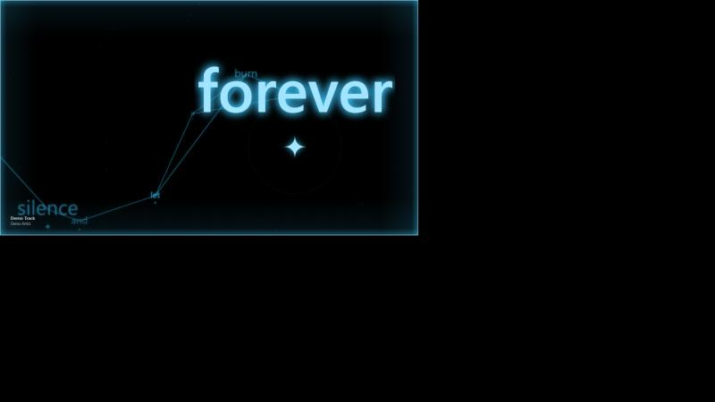

# YTM Skyfield

Synced lyrics for **YouTube Music** as a glowing 3D constellation. Every word is a star, the camera flies through the song, and the whole screen glows in the colour of the album art.

| Lime | Pink | Cyan |
| --- | --- | --- |
|  |  |  |

*Screenshots come from a demo harness with sample lyrics, not a real track.*

## Features

- **Constellation lyrics.** Each lyric line is a constellation placed in 3D space. Upcoming words show as faint dim points, the sung word lights up big with a left-to-right fill and a four-point star under it, and hairlines connect the words.
- **Camera flight.** The camera flies forward through the lines and follows the sung word. Moving the mouse shifts the depth (parallax).
- **Colour match.** The neon screen-border glow, lines and words take their colour from the current album art and change with every song.
- **Tempo styling.** Slow lines use a thin serif, medium lines a sans, and fast lines bold uppercase. Longer-held words are bigger and brighter.
- **Wave in long gaps.** When the lyrics pause for more than 3 seconds while music plays (intro, instrumental, outro), a glowing wave in the cover colour replaces the constellation. Shorter gaps are ignored, and the constellation returns when the lyrics do.
- **Punjabi / Hindi aware.** If the YouTube Music Lyrics tab is open, the extension reads its text and prefers the LRCLIB entry in the same script (Latin, Devanagari or Gurmukhi).
- **Reliable song changes.** Lyrics are looked up in parallel, retried on failure, and re-fetched when a song auto-advances. Press `R` to reload them by hand.
- **Second-monitor window.** The ✦ button on the YouTube Music page opens the viewer in its own window, ready to drag to another screen.

## Install (Chrome / Edge, unpacked)

1. Download or clone this repo.
2. Open `chrome://extensions` and turn on **Developer mode**.
3. Click **Load unpacked** and pick the `extension/` folder.
4. Open [music.youtube.com](https://music.youtube.com) and play a song.
5. Click the **✦** button (or press **Alt+Shift+C**) to open the viewer window.

## Viewer keys

| Key | Action |
| --- | --- |
| `[` / `]` | Shift lyric timing by -0.1 s / +0.1 s (saved) |
| `C` | Toggle album-colour and neon lime |
| `R` | Reload lyrics for the current song |
| `F` or double-click | Fullscreen |

## How it works

- `content.js` runs on YouTube Music. It reads the title, artist, cover and playback position, picks an accent colour from the cover, and streams that state to the extension.
- `background.js` fetches synced lyrics from [LRCLIB](https://lrclib.net) (`/api/get` and several `/api/search` queries run in parallel; the best title, artist, length and script match wins).
- `viewer.html` / `viewer.js` render everything on a canvas.

## Limitations

- LRCLIB has line-level timestamps only. Per-word timing is estimated from word length, so use `[` and `]` to nudge it.
- Tracks missing from LRCLIB show "No synced lyrics for this track" and the wave plays. YouTube Music's own lyrics (LyricFind / Musixmatch) are not synced, so they are only used to match the script.
- Script matching needs the Lyrics tab to have been opened for the song.
- Tested in a demo harness and with the real viewer and LRCLIB on live YouTube Music tracks; the full extension on the live page is lightly tested.

## Credits

Design research drew on [Verso](https://github.com/AkkiCode06/verso), [Lyric Box](https://github.com/trinknx/lyric-box) and [Verci](https://www.verci.xyz/), and on the "Peak music setup" reel that started it.
